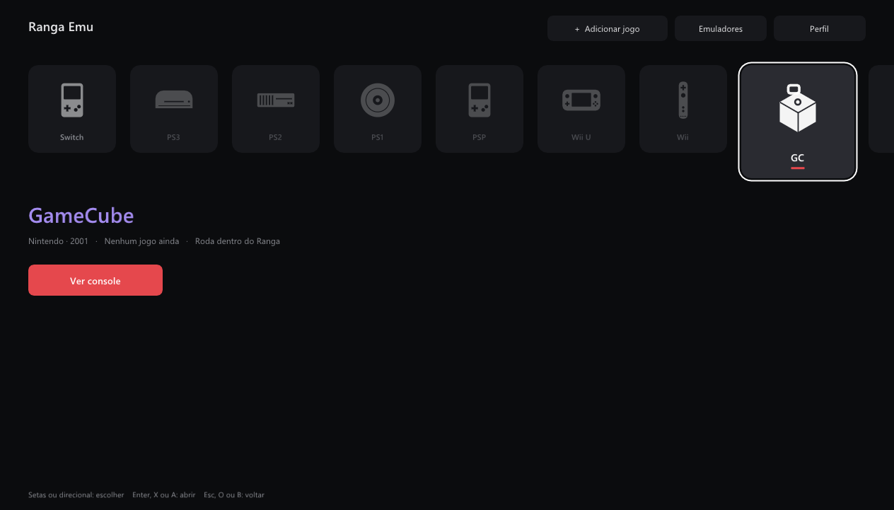

# Ranga Emu

**Uma central de jogos para Windows: todos os seus consoles numa tela só, com perfil, amigos, chat, conquistas e jogo online entre amigos.**



## O que ele faz

- **Biblioteca de 26 consoles.** NES, SNES, Mega Drive, PS1, N64, Saturn, Dreamcast, PS2, GameCube, Wii, Xbox, PSP, DS, 3DS, Wii U, PS3, Xbox 360, Switch e outros, cada um com capa, configurações e controles por jogo.
- **Roda dentro do próprio Ranga.** O Ranga Retro abre os núcleos (libretro) numa janela só, com menu próprio, filtros, escala, FSR e estados salvos. Para quem preferir, cada console também aceita um emulador externo.
- **Perfil estilo Steam.** Nível e XP, horas jogadas, vitrine de conquistas, jogos recentes, foto e capa animadas (GIF ou vídeo curto).
- **Conquistas.** Conquistas do próprio Ranga e do [RetroAchievements](https://retroachievements.org), inclusive em jogos `.chd`.
- **Contas e amigos.** Conta `Nome#1234` com senha e código de recuperação, pedidos de amizade, chat entre amigos e bloqueio. O servidor (Cloudflare Workers + D1, em `launcher/net/cloudflare`) tem limite de contas por PC, prova de trabalho contra robôs e banimento pelo dono.
- **Online entre amigos.**
  - Clássicos (do NES ao PS2) por netplay próprio, com atraso automático pelo ping.
  - Salas do Switch, públicas (lista ao vivo) ou privadas.
  - Salas do 3DS.
  - PSP em ad hoc.
- **Atualização sozinha.** Quem hospeda publica uma versão assinada (ECDSA P-256), e o Ranga dos amigos baixa só o que mudou. A aba **Emuladores > Arquivos do Ranga** confere tudo e baixa de novo o que estiver faltando ou corrompido.

## O que você precisa trazer

O Ranga **não vem com jogos, BIOS, firmware nem chaves** e não baixa nada disso. Use os arquivos do seu próprio console e dos seus próprios jogos.

## Compilar

No Windows, com o toolchain MinGW (GCC 15), CMake 4 e Ninja:

```sh
cmake -S . -B build -G Ninja -DCMAKE_BUILD_TYPE=Release
cmake --build build --target RangaEmu RangaRetro RangaSala
```

- **Endereços próprios:** a fonte da atualização e a sala privada do Switch ficam em `launcher/Enderecos.local.hpp`, que não vai para o git (veja `launcher/Enderecos.hpp`). Sem esse arquivo, o Ranga compila com os dois vazios.
- **Servidor dos amigos:** veja `launcher/net/cloudflare` (`npx wrangler deploy`).

## Onde fica cada parte

| Pasta | O que é |
|---|---|
| `launcher/` | O Ranga Emu (ImGui + Direct3D 11): biblioteca, perfil, amigos, salas, atualização |
| `launcher/retro/` | O Ranga Retro: roda os núcleos libretro, conquistas, netplay |
| `launcher/net/` | Servidor das salas (`ranga-sala`) e o servidor dos amigos na Cloudflare |
| `core/` | O runtime de PS5 herdado do [AnyPS5](https://github.com/boykopovar/AnyPS5) (escondido no Ranga por enquanto) |

## Privacidade: relatório de erro

Quando um jogo fecha com erro, o Ranga pergunta se você quer **Enviar ao Ranga**. Só vai se você apertar o botão; nada é enviado sozinho.

- **O que vai:** a versão do Ranga, o console, o emulador, o nome e o serial do jogo, o código do erro, quantos segundos o jogo rodou e o final dos logs daquela vez.
- **O que é tirado dos logs antes:** seu nome de usuário do Windows, a pasta do seu usuário, o nome do PC, e-mails, endereços IP e linhas com senha ou token.
- **O que não vai:** saves, jogos, BIOS, chaves dos consoles, sua conta e seu IP (o relatório pede para não guardá-lo).
- **Para onde:** para o projeto do Ranga no [Sentry](https://sentry.io), um serviço de relatórios de erro, onde só o dono do Ranga vê. Serve só para achar e consertar o que quebra.
- O **Gerar .zip** continua fazendo o arquivo no seu PC, sem enviar nada.

## Créditos

- O Ranga nasceu de um fork do [AnyPS5](https://github.com/boykopovar/AnyPS5) e do SoS-PS5.
- Bibliotecas usadas:
  - [Dear ImGui](https://github.com/ocornut/imgui)
  - [SDL2](https://www.libsdl.org)
  - [stb](https://github.com/nothings/stb)
  - [rcheevos](https://github.com/RetroAchievements/rcheevos)
  - [libchdr](https://github.com/rtissera/libchdr)
- Núcleos libretro e emuladores: cada um com os seus autores e licenças.

Os nomes dos consoles são marcas dos seus donos e aparecem só para dizer qual console é. O Ranga não tem ligação com nenhum fabricante.

## Licença

GPL v2, a mesma do projeto de origem. Veja [LICENSE](LICENSE).
